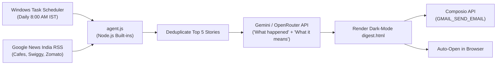

# Cafe News Digest Agent — Scheduled AI Industry Intelligence Pipeline

[](https://nodejs.org/)
[](https://ai.google.dev/)
[](https://composio.dev/)
[](./LICENSE)

A **zero-dependency Node.js automation agent** that runs on a daily schedule (8:00 AM IST via Windows Task Scheduler), monitors Indian cafe, restaurant, Swiggy, and Zomato news via Google News RSS, summarizes the top 5 unique stories with **Google Gemini** (or OpenRouter), renders a dark-themed HTML intelligence brief, and emails it automatically via the **Composio Gmail API**.

> **Note:** Built for sample agency operations (*PlateAndPost* cafe/restaurant clients). All keys and recipient emails are configured via local ignored files / environment variables.

---

## How It Works



---

## Key Features

* **Zero External npm Dependencies:** Uses only Node.js built-in modules (`https`, `fs`, `path`, `child_process`, native `fetch`).
* **Smart RSS Parsing & Deduplication:** Normalizes headlines and filters duplicates to surface the top 5 unique industry stories.
* **Dual LLM Provider Support:** Automatically detects OpenRouter (`sk-or-*`) vs. Google Gemini API keys and gracefully degrades with a clear notice banner if no API key is present.
* **Actionable Business Framing:** Prompts the AI to output two focused lines per story:
  1. *Happened:* One factual summary sentence.
  2. *Means:* How cafe owners can act on it (menu promos, food photography, Reels, delivery algorithms).
* **Automated Email & Local Report:** Sends HTML email via Composio (`GMAIL_SEND_EMAIL`) and writes a styled local report (`sample-digest.html`).

---

## Setup & Usage

1. Copy `.env.example` for reference:
   * Put your Gemini or OpenRouter key in `key.txt` (gitignored).
   * Put your Composio API key in `composio-key.txt` (gitignored).
   * Set `RECIPIENT_EMAIL` in your environment:
     ```bash
     export RECIPIENT_EMAIL="your-email@example.com"
     ```
2. Run manually:
   ```bash
   node agent.js
   ```
3. *(Optional)* Import `schedule.xml` into **Windows Task Scheduler** to run daily at 8:00 AM.

---

## Files

* `agent.js` — Main RSS ingestion, AI summarization, HTML rendering, and Composio email dispatch script.
* `schedule.xml` — Windows Task Scheduler XML configuration (`\CafeNewsDigest`).
* `sample-digest.html` — Example generated dark-mode HTML intelligence digest.
* `.env.example` — Environment and key configuration template.

---

## License

MIT License — Copyright (c) 2026 Karthik Karka. See [LICENSE](./LICENSE).
